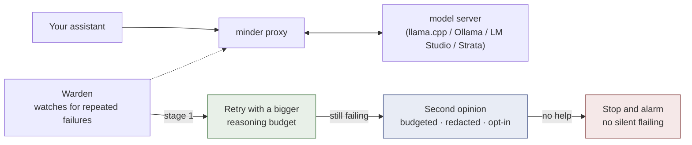
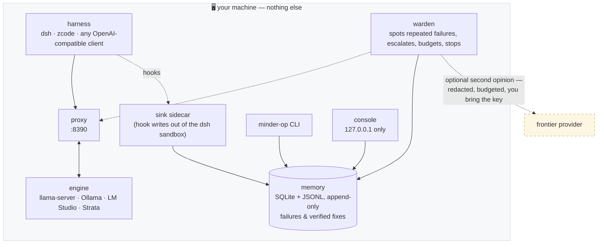

<div align="center">

# minder

**A supervisor for AI assistants — running entirely on your own computer.**

[](https://github.com/xyzzing/minder/actions/workflows/ci.yml)
[](https://github.com/xyzzing/minder/releases)
[](LICENSE)
[](https://www.python.org/)
[](#requirements)
[](#privacy-and-safety-posture)
[](#any-openai-compatible-harness---generic-no-linux-required)

[What it does](#what-minder-does) · [2-minute try](#try-it-in-two-minutes-nothing-installed-nothing-sent) · [How it works](#the-pieces) · [Operator guide](#operator-guide) · [Privacy](#privacy-and-safety-posture)

</div>

---

> **The problem it solves.** You ask an AI assistant for something. The answer
> is wrong. You point that out — and it makes the same mistake again, with
> more confidence. minder watches the work an AI assistant does on your
> computer, and when the same failure keeps coming back, it steps in —
> in stages, with a written record of every decision.

## What minder does

When your assistant gets stuck, minder escalates in three stages:



1. **A retry with more careful thinking.** minder re-sends the request with a
   bigger reasoning budget, so the model works the problem instead of
   guessing again.
2. **A second opinion.** If the retry fails too, minder can consult a bigger
   model from an outside provider. You set the budget, your text is redacted
   before anything is stored, and minder records only labels and hashes —
   never the raw conversation.
3. **A clear stop.** If the second opinion does not help, minder raises an
   alarm instead of letting the assistant keep flailing.

Everything minder decides is written to an **append-only log** — entries go
in, nothing gets edited out. *"What did the supervisor do last night?"* is a
one-command answer, not an archaeology project.

> 🔒 **Nothing leaves your machine.** The log is a local database file, the
> web console only answers on `127.0.0.1` (your computer's private loopback
> address, unreachable from the network), and there is no telemetry. The only
> optional outbound call is the second opinion — to a provider you configure,
> after redaction.

### Why three kinds of people run it

| You are… | minder gives you |
|---|---|
| 🧑‍💻 **A developer running a local AI assistant** | A supervisor in front of your model: failures spotted, retries escalated on evidence, budgeted second opinions — and a local record of all of it. |
| 🧐 **Someone who needs proof, not vibes** | Append-only evidence (SQLite + JSONL), protected benchmark comparison where safety regressions fail at any sample size, and "it got better" as a measured claim. |
| 🔐 **Privacy-constrained** | Local-first by construction: no telemetry, loopback-only console, secrets redacted at write time, redacted consults that store hashes — never raw prompts. |

Coding is where minder is installed deepest today, but the same machinery —
staged escalation, budgets, append-only evidence, rule-anchored benchmarks —
covers trading, finance, sustainability, privacy law and resume work.
See [Domains](#beyond-coding-one-governance-kernel-many-subject-areas).

**How to read this file:** everything down to the *Operator guide* divider is
for everyone. The [Operator guide](#operator-guide) is for people installing
and running minder — commands to type, configuration files, and test suites.
Each command is shown with a plain-language comment saying what it answers.

## Is this for you?

minder runs on your own computer, watches one AI assistant at a time, and
shows its evidence as terminal output and a local web page. There is nothing
to double-click and nothing hosted anywhere.

| ✅ It will suit you if… | ❌ It is not for you if… |
|---|---|
| You run an AI coding assistant locally | You want a hosted service or team dashboard (minder is deliberately single-machine, single-user) |
| You want a record of what it does and why | You need a Windows program (not yet) |
| You'd rather have fixed rules spend a small second-opinion budget than let a model retry forever | You want a tool that changes model behavior by itself (minder's models only **propose**; fixed rules **decide**) |

## Try it in two minutes (nothing installed, nothing sent)

The operator tools read minder's local evidence store and work even without a
running model. On a fresh machine they report empty state — which is itself
the demonstration: this is what honesty about "nothing happened yet" looks
like.

You do not need a GitHub account. On this page, click the green **Code**
button, then **Download ZIP**, then unzip anywhere. (If you have git,
`git clone https://github.com/xyzzing/minder` does the same and updates later
with `git pull`.)

```bash
cd Downloads/minder-main      # the unzipped folder name ends in -main

python3 -m minder_op doctor --no-probe          # is an install healthy, and why not
python3 -m minder_op status                     # schema, counts, flags
python3 -m minder_op weekly-summary             # observed workflow evidence, no claims
python3 -m minder_op events ls --limit 10       # raw failure events, redacted
python3 -m minder_op capture                    # is the watchdog recording anything at all?
python3 -m minder_op scorecard                  # capture, cost, failures, learning, context, hygiene
```

The web console shows the same evidence in a browser:

```bash
pip install --user -r requirements-web.txt
python3 -m minder_web --port 8765 --db ~/.local/state/minder/memory.sqlite
# then open http://127.0.0.1:8765  (127.0.0.1 means "this computer only")
```

Nothing here configures an assistant, starts a model, or writes outside
`~/.local/state/minder`. That is the operator guide's job.

<details>
<summary><b>Already running a local model?</b> (Ollama, LM Studio, llama-server) — attach minder to it</summary>

minder attaches to what you already have. The generic install needs Python
3.10+ only — no Linux, no systemd — and speaks the standard OpenAI chat
format, so anything that can point at a web address can point at minder's
proxy instead:

```bash
./install.sh --generic --upstream http://127.0.0.1:11434/v1  # Ollama
# LM Studio:    http://127.0.0.1:1234/v1
# llama-server: http://127.0.0.1:8080
```

Then point your assistant at `http://127.0.0.1:8390/v1` instead of the model's
own address. Every request now passes the supervisor: failures spotted,
retries escalated on evidence, second opinions budgeted, everything logged
locally. To go back, point your assistant at the model directly again —
minder sits in front, not inside.

</details>

## The pieces



| Piece | What it does in practice |
|---|---|
| **Proxy** | A small go-between. Your assistant sends requests to the proxy; the proxy forwards them to the model. It speaks the standard OpenAI chat format, so any assistant that can point at a web address works. |
| **Warden** | The supervisor itself: spots repeated failures, upgrades retries to deeper thinking, spends second-opinion budgets, then stops and alarms. |
| **Memory** | A local database of past failures and verified fixes, so last week's dead end is not rediscovered this week. |
| **Decision gateway** | When smarter components (classifiers, models) suggest an action, they only propose. A fixed rule set decides, and a new component must beat the old rules on pinned benchmarks before it is trusted. |
| **Operator tools** | The `minder-op` command and a localhost web page for reading the evidence. |
| **Benchmarks** | Versioned test suites with tamper-resistant comparison, so "it got better" is a measured claim, not a feeling. |

Two rules hold across all of it: **fixed policy always decides** (models only
propose), and **history is append-only**. Corrections add evidence; the
record is never rewritten.

## Beyond coding: one governance kernel, many subject areas

Coding is minder's first domain, not its only one. Staged escalation,
budgets, append-only evidence and rule-anchored benchmarks do not care what
the work is. A new domain plugs in without changing the kernel:

- **A profile.** `minder.json` carries named profiles (coding, trading,
  legal, …) whose settings overlay the defaults, so budgets and thresholds
  differ per domain while the machinery stays the same.
- **Explicit task boundaries.** A task is declared with
  `minder-op task declare` before the work starts, and evidence attaches to
  that boundary instead of floating free.
- **Code oracles, not judge models.** Three suites generate business-rule
  cases whose right answer is fixed by a published rule, then grade with
  code — the grading itself cannot be argued with.

| Suite | Covers |
|---|---|
| `domain-core-v1` | Singapore carbon tax & GHG Scope 2 accounting · CFO-office finance (GST, NPV, loan annuity, IFRS 16) · UCP 600 letter-of-credit examination · Incoterms 2020 risk allocation · procurement controls (delegation of authority, three-way match, segregation of duties) · PDPA breach notification |
| `legal-core-v1` | Legal deadline arithmetic: PDPA breach notification, the Limitation Act 1959 six-year contract/tort window, Employment Act salary payment timing |
| `finance-core-v1` | The finance family isolated on its own |

  Saying "insufficient data" when an input is missing is scored too, and
  fabricated quotes are caught verbatim. Seeds at 1000 and above are a
  holdout split the suite never trains on.
- **Preregistration where money is involved.** The trading research protocol
  (`minder-op families`) registers a strategy family with a method digest and
  metric before any trial runs, records trials on declared
  train/validation/holdout splits, and expects analysis methods from the
  literature (PBO/CSCV, DSR, PSR, SPA). The holdout stays locked until an
  explicit, recorded unlock. The same tamper-evident, append-only history
  backs audit-grade domains such as legal.

Also shipped: resume evidence (`minder-op resume`) keeps career facts,
wording and intent as separately asserted, correctable, expiring records; and
domain routing — deciding which profile or model handles a task — runs
observe-only, proposing in a shadow log until a classifier beats the
deterministic baseline on `routing-core-v1`.

The roadmap shape: each new domain is **one profile, one rule-anchored eval
suite, and — for money-touching domains — preregistration**. The kernel
itself does not change.

---

# Operator guide

From here on it is commands to type, configuration files, and test suites.
Each command carries a plain-language comment saying what it answers.

## Requirements

- **Python 3.10+** — the core of minder is written using only what Python
  ships with: nothing to install beyond Python itself.
- Optional web console: `pip install --user -r requirements-web.txt`
- Optional local classifier model:
  [laya](https://huggingface.co/convaiinnovations/laya) (see below)
- A full governed runtime also needs a **local model server** — a program
  that runs the AI model on this computer, such as llama.cpp's
  `llama-server` or the strata-amd server. ("OpenAI-compatible" means it
  accepts requests in the standard OpenAI chat format.)

A **"harness"** below means the software your AI assistant runs inside. The
systemd/dsh/zcode integration tier needs Linux (systemd is the part of Linux
that starts and restarts background programs for you); the generic proxy path
works anywhere Python runs.

## The full runtime (with a local model)

### Any OpenAI-compatible harness (`--generic`, no Linux required)

```bash
git clone https://github.com/xyzzing/minder && cd minder
./install.sh --generic --upstream http://127.0.0.1:8080
MINDER_UPSTREAM=http://127.0.0.1:8080 ~/.local/share/minder/proxy.py &
# then point your harness at http://127.0.0.1:8390/v1
# models: qwen-exec | qwen-think | qwen-auto (auto = escalation-managed)
```

`--generic` stages the code, probes your server's real capabilities
(fail-closed ladder, same as below), writes the config and the operator
shims, and touches nothing else: no dsh/zcode wiring, no systemd. The proxy
upgrades reasoning budgets when it sees minder's escalation markers in recent
context, so the supervisor works through the base URL alone.

### dsh + zcode (Linux with systemd, first-class hooks)

```bash
./install.sh --upstream http://127.0.0.1:8080 [--skip-dsh] [--skip-zcode] [--no-start]
```

The installer probes your server's actual capabilities (thinking toggles,
effort names, tool-call dialects), installs a capability-appropriate
fail-closed ladder, merges zcode/dsh hook config (with backups), and installs
a systemd `--user` unit. Behaviour flags are environment-owned and read at
hook start:

```bash
MINDER_ASSIST=off | retrieve | decision_skill      # digest-level assistance
MINDER_CLASSIFIER=shadow                           # log-only classifier labels
MINDER_DECISION=shadow                             # log-only gateway traces
MINDER_INJECTION_GUARD=off | shadow                # proxy request scan, records only
MINDER_HOOK_FAIL_MODE=closed                       # hook crash blocks the call (default: open)
```

<details>
<summary>Injection guard, fail modes, and second-opinion runners (details)</summary>

The proxy's injection guard (`MINDER_INJECTION_GUARD`) is off by default.
`shadow` gives every proxied request one prompt-injection opinion from an
isolated worker process (`minder_decision/injection_worker.py`, spawned on
demand with a per-request deadline on both sides); the request is never
modified, and each opinion lands as an `injection_shadow` ledger event plus a
row in the memory store, which `minder-op doctor` (guard mode, worker state)
and `minder-op status` (`injection_shadow_rows`) read back. The classifier is
Llama Prompt Guard 2 via transformers —
`pip install --user "minder[guard]"` — and when it is not installed the
worker reports unavailable, no opinion is recorded, and doctor says so.

By default a hook failure never blocks a tool call.
`MINDER_HOOK_FAIL_MODE=closed` opts the hook's outer guard into fail-closed:
an uncaught exception blocks the call (dsh exit 2 with a digest naming the
failure, zcode a block decision). It covers that guard only; the deliberate
inner fail-opens (malformed stdin, directive failures) still allow the call,
because blocking every tool call on malformed input would brick the harness.

Second-opinion consults run through the bundled `frontier.py` runner or your
own via `--frontier-cmd`. Bring your own API key; minder never ships one.

</details>

### Switching the model server

The proxy serves one model server ("engine") at a time. To point a running
install at a different OpenAI-compatible server, add a systemd drop-in and
restart:

```bash
mkdir -p ~/.config/systemd/user/minder-proxy.service.d
cat > ~/.config/systemd/user/minder-proxy.service.d/upstream.conf <<'EOF'
[Service]
Environment=MINDER_UPSTREAM=http://127.0.0.1:8081
EOF
systemctl --user daemon-reload && systemctl --user restart minder-proxy
```

The proxy re-runs the capability probe against the new server on boot and
rewrites `model_caps.json`, so thinking mechanisms and tool-call dialects are
re-measured on every switch. Presets only need changes if the new server
validates model names; a server that ignores them works with the installed
presets as-is. Two engines competing for the same GPU cannot run concurrently:
stop one before starting the other. While the configured engine is down, the
proxy returns an honest 502 (`minder_upstream_unavailable`) instead of
failing silently.

<details>
<summary>Engine registry, lifecycle switching, and room policies (details)</summary>

**Engine registry.** For installs that move between engines regularly,
`minder.json` can name them. Each entry carries the engine's address and the
systemd user unit that runs it; `active_engine` picks which one the proxy
forwards to:

```json
{
  "engines": {
    "llama":  {"upstream": "http://127.0.0.1:8080", "unit": "llama-model@qwen27b"},
    "strata": {"upstream": "http://127.0.0.1:8081", "unit": "strata-hip"}
  },
  "active_engine": "llama"
}
```

With a registry present the proxy re-resolves the active engine on every
request, so switching is a one-line config edit and a unit restart, with no
proxy restart. Capabilities are measured per engine into
`model_caps.<engine>.json`. An install without an `engines` key keeps the
single-server behavior above.

**Switching engines (lifecycle).** When each engine entry carries a systemd
user `unit`, the operator CLI and the console can do the whole switch: stop
the current engine unit, start the target, health-check it, and only then
flip `active_engine` in `minder.json` (a backup is written to
`minder.json.bak`). A target that never becomes healthy rolls back to the
previous engine, so a failed switch cannot leave you without a working model.

```bash
minder-op engine status             # rows: active flag, unit state, health
minder-op engine switch strata --yes
```

**Room policies.** A room policy says how much room to think each task
difficulty should get, measured by the separate Windtunnel project (a sweep
over the graded suites). `minder-op room apply --policy room-policy.json`
validates the file, checks the model fingerprint against the live engine, and
shows the `difficulty_bands` diff it would write; `--write` backs up the
config first, and rules that would flip a minder default (thinking off in
automatic mode) need an explicit `--opt-in`. Dry run by default — nothing
changes until you say so.

The console exposes the same switch at `/engine`: the row links to a confirm
step that names the unit it will stop and the upstream it will flip, and the
switch itself still needs the POST from that page (issue #12). `doctor`
reports the active engine's health and warns when two engine units run at the
same time, because they compete for the GPU. `install.sh --engine NAME=URL[,UNIT]`
(repeatable) plus `--active-engine NAME` write the registry at install time.

</details>

## The web console

Every page leads with one plain-language answer — what the page concludes and
what to do first — then the tables, then a collapsed "raw fields" section
with the storage field names and the values exactly as stored, so a screen
can be checked line by line against the CLI. An empty store is stated as
empty, never as a zero (issue #12).

The landing page states how current its evidence is, and the `/domains` page
answers, in plain words, what minder knows about your field: the active
profile and its budgets, each eval suite with a verdict (pinned baseline, not
yet comparable, or invalid), the provenance grade of every domain rule
(primary means read from the authoritative source; secondary means re-verify
before relying on it externally), and whether the difficulty router is
actually changing requests or only logging. It is read-only — profiles are
still set by hand in `minder.json`.

`capture` and `scorecard` read dsh's own session store (`~/.dsh`, or
`$MINDER_DSH_HOME`). dsh is one of the two assistant tools minder integrates
with deeply (the other is zcode). dsh hooks run inside a file sandbox whose
only writable path is the session workspace, so they cannot write minder's
state directory themselves; the loopback `sink.py` sidecar (a small helper
program) does it for them (see
[docs/operator-web.md](docs/operator-web.md#capture-how-the-hooks-persist)).
The console's `/capture`, `/sessions` and `/scorecard` pages show the same
data.

`install.sh` leaves `minder-op` / `minder-web` / `minder-sink` shims in
`~/.local/bin` (usable from any directory). Without them, run the modules
from the repo checkout: `python3 -m minder_op ...`.

Exit codes: `0` ok, `1` usage/not-found, `2` DB missing or corrupt. All data
lives under `~/.local/state/minder/`. Nothing leaves the machine.

## Benchmarks and evaluation

### Multi-turn prompt-cache replay

`benchmarks/multiturn_cache.py` replays a growing conversation against any
OpenAI-compatible engine under three request patterns (append-only,
alternating thinking flags, reordered history) and reports per-turn cache
reuse from usage or engine metrics:

```bash
python3 benchmarks/multiturn_cache.py --base-url http://127.0.0.1:8081 \
    --turns 12 --tail-chars 1200 --json-out /tmp/multiturn.json
```

Measured against the strata-amd HIP build (2026-10-01; a "fork" is a copy of
another project carrying local changes): the append-only pattern re-reads
about 263 tokens per turn (86% reuse; a token is roughly a short word, and
re-reading is the per-turn cost of the model re-reading your conversation) —
alternating thinking flags re-read the whole conversation every turn (2.3×
the wall-clock time at 3,600-token conversations, and it grows with
conversation length); a one-time history reorder costs one re-prefill and
then caching resumes. This is why the proxy pins thinking settings per
session on single-slot engines. The strata build's usage report omits
`cached_tokens`, so on strata the ledger's reuse field stays empty until the
engine publishes its internal `reused` counter in the OpenAI usage shape.

### Coding suites with protected comparison

```bash
python3 -m minder_op benchmark list
python3 -m minder_op benchmark validate --suite coding-core-v1
python3 -m minder_op benchmark run --suite coding-core-v1 --task t3_keyerror_default \
    --execute --i-understand-this-runs-local-agent-tasks
python3 -m minder_op benchmark baseline create REPORT.json --yes   # never automatic
python3 -m minder_op benchmark compare BASELINE.json CANDIDATE.json
```

Protected comparison rules: unsafe execution / harmful-frontier /
prohibited egress > 0 means **FAIL** at any sample size; fewer than 20
comparable runs means **INSUFFICIENT_SAMPLE**; a completion drop over 5
points means **FAIL**; a fingerprint mismatch means **NON_COMPARABLE**.
`routing-core-v1` replays 40 adversarial domain-routing cases through any
provider (`minder-op routes replay --provider rules|laya|null`) using the
same comparator.

### Non-coding domains: `domain-core-v1`

Finance, trade finance, sustainability and governance tasks graded by **code
oracles** instead of a judge model (another AI asked "was this answer
good?"). A code oracle instead checks the answer against a published rule,
so the grading itself cannot be argued with. Seeded generators produce
unlimited cases from the same distributions. Each case has a unique answer
fixed by a rule (GST, IFRS 16, UCP 600, Incoterms 2020, the Singapore Carbon
Pricing Act, PDPA Part 6A) or by a stated company policy. The suite also
scores abstention (`insufficient_data` when an input is missing), fabricated
evidence in document extraction, and metamorphic consistency (the same
question in a different costume must get the same answer).

The generators, grader and rule provenance for this suite live in a separate
extraction project (Windtunnel), not in this repository; minder keeps only
the suites that test minder itself (coding, routing, difficulty). The
console's `/domains` page still renders the rule provenance table when
`rulebook_provenance_path` points at Windtunnel's `rules --json` output, and
shows "not available" otherwise.

## Use the pieces without the runtime

These parts of minder are deliberately dependency-free (Python standard
library only, zero minder imports) and importable from `minder_core`:

- **`minder_core.comparator`** — the protected-metric benchmark comparator
  behind `minder-op benchmark compare`: safety regressions fail at any
  sample size, completion drops are bounded, and the sample-size and
  fingerprint guards cannot be argued into a PASS.
- **`minder_core.identity`** — canonical failure keys, action fingerprints,
  secret redaction, and result signatures: the exact functions minder's
  evidence log is keyed by.
- **`minder_core.panel_text`** — the frontier panel's prompts and the one
  answer shape they ask for, plus the egress redaction applied to what leaves
  the machine.
- **`minder_core.panel_answer`** — the reading half of that shape: which
  lines of an answer are the action the answer itself named, which are only
  causes, which are another model's attribution.

```python
from minder_core import compare_reports, failure_key, result_signature
```

## Privacy and safety posture

- **Local-first.** SQLite + JSONL logs in `~/.local/state/minder/`; the web
  console binds `127.0.0.1` only and refuses any other address; no telemetry.
  Your work is never sent anywhere by minder itself; the only optional
  outbound call is the second opinion, to a provider you configure, after
  redaction.
- **Redaction at write time.** Secrets and API-key-shaped strings are
  redacted when records are written; consult traces store hashes, never raw
  prompts or responses.
- **Fixed policy decides.** Models and classifiers propose. Corrections
  append evidence; history is never rewritten. No automatic skill apply, no
  DB-edited flags, no trading execution path.

## Status and known limits

Current release: **v0.8.2** (see [CHANGELOG](CHANGELOG.md)). On main, the
dual-engine work is also shipped: an engine registry with per-engine
capability measurement, a request queue and prompt-cache protections for
single-slot engines like strata-amd, and a lifecycle switch in the CLI and
the console (`minder-op engine switch`, `/engine`).

| | |
|---|---|
| ✅ **Shipped** | The governed runtime through the operator plane (CLI, weekly summary, console); the benchmark harness with a sandboxed runner; domain governance phases 1–2 — explicit task boundaries, a trading preregistration protocol, resume fact-vs-intent evidence, observe-only domain routing (the deterministic baseline measures 40/40 on the shipped fixture set). |
| 🚧 **Not here yet** | Multi-user or remote access (by design) · models beyond the qwen3 presets (untested) · Windows · a public docs site · classifier providers that beat the deterministic baseline. *The harness will tell you when one does.* |

Worth knowing: dsh runs command hooks inside its file sandbox, whose only
writable path is the session workspace. A hook therefore cannot write
`~/.local/state/minder` directly (it gets `EROFS`), and because every hook
write is fail-open, that loss would be silent. `sink.py` (a loopback
systemd `--user` sidecar) performs those writes and keeps the laya models
warm; `minder-op capture` is the check that says whether it is working. The
mechanics and the ten monitored metrics are in
[docs/operator-web.md](docs/operator-web.md#capture-how-the-hooks-persist).

## Related projects

minder is one layer of a local-AI stack. These are separate tools that slot
in around it:

| Project | Role in the stack |
|---|---|
| [cupola](https://github.com/xyzzing/cupola) | The serving cell above the engine: certify-before-serve and work backpressure — supervises the *engine* process below minder, on AMD Radeon. |
| [Strata](https://github.com/xyzzing/Strata) | The inference engine this stack is measured on. |
| [windroos](https://github.com/xyzzing/windroos) | The repo agent: captures lessons and charts from every run. |
| [mews](https://github.com/xyzzing/mews) | The house of this stack: contract-drift tripwires, full-loop shakedown, program map. |

## Development

```bash
python3 -m pytest -q        # no network, no model required
ruff check .                # config: ruff.toml (CI enforces it)
```

The test suite is the fastest way to see what minder promises: each test name
is one behavior.

Packaging: `pip wheel . --no-deps` builds a wheel of the operator plane +
`minder_core` (entry points `minder-op` / `minder-web`, version synced to
`MINDER_VERSION` in minder.py). The hook transports, proxy and sink stay
staged by `install.sh`; they are wired to a real model server and a specific
harness, which a wheel cannot do honestly.

Optional: install the laya local routing model (`pip install --user torch
--index-url https://download.pytorch.org/whl/cpu && pip install --user laya`)
and the marked tests exercise it.

MIT, see [LICENSE](LICENSE).
